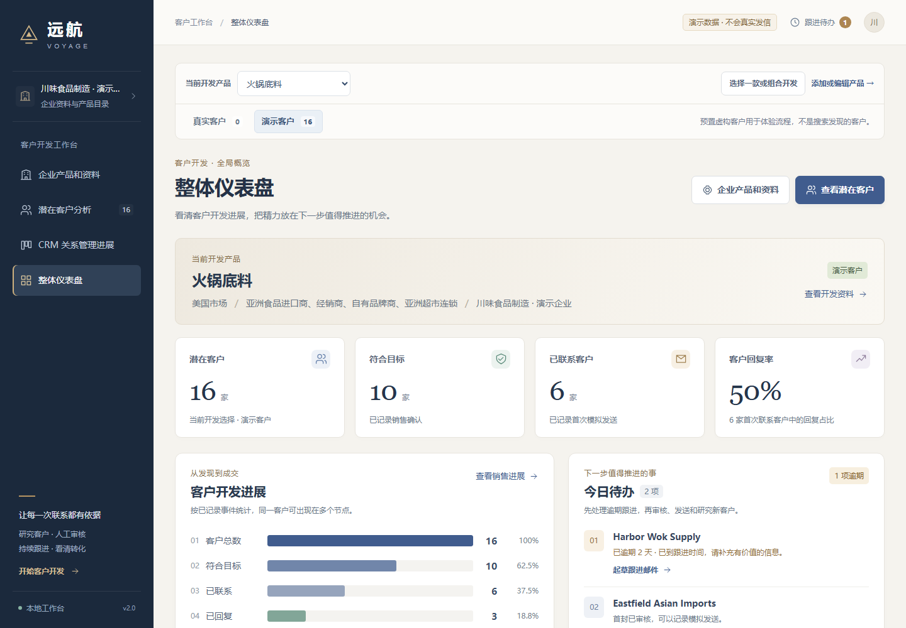
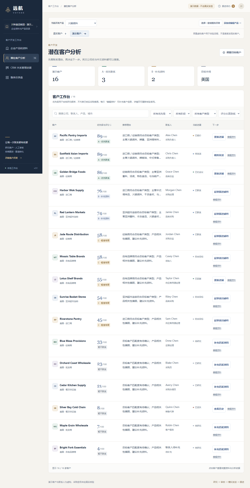

# 远航 · 企业 B2B 出海拓客平台

面向中国中小外贸团队的客户开发与销售跟进工作台。从企业与产品资料开始，完成客户研究、邮件起草与审核、销售进展管理和复盘。

报名项目名称为**企业b2b出海拓客平台**，参赛赛道为开源基础软件与解决方案，负责人林梓涵。



## 快速运行

推荐 Node.js **24**，最低支持 22.18，并需安装 npm。首次安装需要网络，默认本地模式无需配置模型密钥或数据库。

下载本仓库并解压后，在项目目录打开终端：

```bash
npm ci
npm run dev -- --hostname 127.0.0.1 --port 3000
```

打开 http://127.0.0.1:3000 。终端中的服务需要保持运行。若 3000 端口已占用，可将命令中的端口改为 3001。

正式构建和启动：

```bash
npm test
npm run lint
npm run build
npm run start -- --hostname 127.0.0.1 --port 3000
```

在同一目录运行时，先停止开发服务，再执行生产构建。

## 从哪里开始

1. 打开“企业产品和资料”，填写并保存企业资料，再保存产品和目标市场。
2. 进入“潜在客户分析”，查看客户档案、适配理由与优先级。
3. 打开客户详情，核对联系依据，起草英文开发邮件。
4. 编辑并人工审核邮件，记录联系进展与后续跟进。
5. 在销售进展看板管理阶段和日期，在整体仪表盘查看待办及事件统计。

可上传 [两款产品示例 CSV](docs/examples/企业与两款产品示例.csv) 体验资料导入。多款产品可以分别开发，也可以选成组合；草稿、进展和活动按开发选择分别保存。



## 可选在线服务

默认本地规则与草稿功能可直接使用。需要在线模型时，把 `.env.example` 复制为 `.env.local`，在服务端填写配置并重启服务。

- `INTERN_API_KEY`、`INTERN_BASE_URL`、`INTERN_MODEL`：客户分析与文案辅助。
- `IMPORT_API_KEY`、`IMPORT_PROVIDER`、`IMPORT_BASE_URL`、`IMPORT_MODEL`：可选的资料导入模型。
- `EXA_API_KEY`：可选的公开网页检索配置。

配置文件仅留在运行环境中；仓库中的 `.env.example` 不包含密钥。

## 当前版本

数据保存在当前浏览器；界面案例为示例数据，发送为流程模拟。在线检索和模型能力依赖相应服务的可用性与配置。共享数据库、真实邮件服务和多人账号列入后续接入计划。

## 项目结构

```text
src/app/          页面路由与服务端接口
src/components/   企业资料、客户、邮件、销售看板和仪表盘
src/lib/          领域规则、审核、评分、持久化和模型适配
src/data/         本地示例数据
public/           静态资源
tests/            业务规则测试
docs/             架构、使用示例与界面截图
.github/          自动检查与协作模板
```

技术栈为 Next.js、React、TypeScript、Tailwind CSS。依赖版本由 `package-lock.json` 固定。

## 检查与参与

```bash
npm test
npm run lint
npm run typecheck
npm run build
```

提交问题或改动前请阅读 [贡献指南](CONTRIBUTING.md)。架构与数据流见 [架构说明](docs/架构说明.md)。

主项目开源协议正在确认；确定后会在仓库根目录提供 LICENSE。第三方依赖及其许可见 [第三方依赖说明](THIRD_PARTY_NOTICES.md)。
